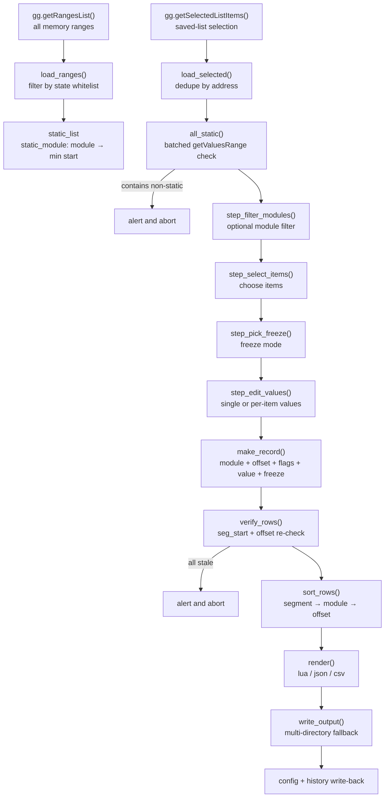

# Lib_Tool R1

> **Static base-address extractor for GameGuardian** — turns absolute addresses from the saved list into a reusable *module + offset* pair that survives a process restart, and exports it as Lua / JSON / CSV.

[简体中文](README.md) · **English**


Author / feedback: **TG [@xsnbyyds](https://t.me/xsnbyyds)**

---

## Table of Contents

- [Overview](#overview)
- [Features](#features)
- [How It Works](#how-it-works)
- [Requirements](#requirements)
- [Installation](#installation)
- [Quick Start](#quick-start)
- [Walkthrough](#walkthrough)
- [Output Formats](#output-formats)
- [Using the Generated Script](#using-the-generated-script)
- [Configuration](#configuration)
- [Repository Layout](#repository-layout)
- [Implementation Highlights](#implementation-highlights)
- [Known Limitations](#known-limitations)
- [FAQ and Troubleshooting](#faq-and-troubleshooting)
- [Function Index](#function-index)
- [License](#license)
- [Disclaimer](#disclaimer)

---

## Overview

GameGuardian's (GG) search results and saved list store **absolute memory addresses**. Once the process restarts, the `.so` is mapped at a different base and yesterday's `0x7A1A2B3C` points at something completely unrelated. That is why most GG scripts work today and break tomorrow.

`Lib_Tool` does exactly one thing: **it converts an absolute address back into a relative one.**

While the target process is running, the script reads GG's memory range table, finds which **static segment** of which loaded module each selected address belongs to, and computes:

```
offset = absolute address − smallest start among the module's static segments
```

The result is a record of `module + offset + type (flags) + initial value + freeze flag`. On the next launch, as long as the module is loaded again:

```
runtime base = gg.getRangesList("libxxx.so")[1].start
target address = runtime base + offset
```

That is what people call a "static base address".

The script itself **does not search, modify, read or write game data** — it only does address arithmetic and file export, and every write goes to the output path you specify.

---

## Features

| Area | Capability |
| --- | --- |
| **Validation** | Static-segment `state` whitelist + a single batched `gg.getValuesRange` call + offset re-check; non-static addresses are rejected at the entrance |
| **Module filter** | When the selection spans several `.so` files, filter by module first so unrelated modules don't end up in one config |
| **Value editing** | One value for everything, or per-item values; defaults are pre-filled from the saved list |
| **Freeze control** | Freeze all / freeze none / pick per item; the freeze flag is baked into each record, so sorting can't misalign it |
| **Multi-format output** | Lua script, JSON and CSV; pick one or emit all at once, with extensions derived automatically |
| **Robust writing** | Works around the Android 11+ FUSE stale-dentry issue; cycles four `io.open` modes; falls back to the script folder / `/sdcard` / `/storage/emulated/0`, and renames the file if the target path is unusable |
| **Path normalisation** | Handles `content://`, SAF `tree/document` URIs, the `primary:` prefix and percent-escapes without corrupting UTF-8 filenames |
| **Config persistence** | Dual storage — a real file plus a GG variable slot; either one is enough. Corrupted config falls back to defaults with a toast |
| **Interaction** | Persistent floating button, looping main menu; tapping empty space or Back only cancels the current step |
| **Bilingual UI** | Every string goes through an i18n table; the main menu's "Language / 语言" toggles Chinese/English, the choice is stored in the config and restored on the next launch |
| **Error containment** | The menu runs inside `pcall` — an exception shows an alert instead of killing the script; `gg.sleep` yields CPU |

---

## How It Works



In one line:

```
range table ──┐
              ├─→ record(module, offset, flags, value, freeze) ─→ sort ─→ render ─→ write ─→ remember
selection ────┘
```

---

## Requirements

| Item | Requirement |
| --- | --- |
| OS | Android (rooted, or running inside a virtual-space / dual-app environment supported by GG) |
| Host | GameGuardian, **attached to the target process** |
| Language | Lua, provided by GG's built-in interpreter — nothing to install; syntax is compatible with Lua 5.1–5.5 |
| Permissions | Write access to the target directory (on Android 11+ grant "All files access" or use an app-private directory) |
| Screen | Any; the floating button overlays the game |

GG APIs used:

| API | Purpose |
| --- | --- |
| `gg.getFile()` | Derive the script directory (default output/config location) |
| `gg.getRangesList()` | Memory range table; with an argument it filters by module (used by the generated script) |
| `gg.getValuesRange()` | Batched segment state lookup for static validation |
| `gg.getSelectedListItems()` | Read the saved-list selection |
| `gg.setValues()` / `gg.addListItems()` | Writing and freezing in the generated Lua script |
| `gg.choice` / `gg.multiChoice` / `gg.prompt` / `gg.alert` / `gg.toast` | All interaction |
| `gg.showUiButton` / `gg.isClickedUiButton` / `gg.hideUiButton` | Floating button and main loop |
| `gg.saveVariable` / `gg.getVariables` | Fallback storage for the config |
| `gg.sleep` | Loop throttling and post-write verification delay |

> If a GG build lacks `gg.saveVariable` / `gg.getVariables`, the config degrades to file-only storage. Nothing else changes — both `write_cfg` and `cfg_blob_from_gg` check for the API first.

---

## Installation

1. Download `Lib_Tool R1.lua`.
2. Put it anywhere readable, typically:
   - `/sdcard/` (i.e. `/storage/emulated/0/`)
   - GG's own script folder
   - or load it straight from Downloads via *Execute script → select file*
3. Open GG → select the target game process (**you must attach first**).
4. GG side panel → Execute script → `Lib_Tool R1.lua`.
5. The first run creates the config file (see [Configuration](#configuration)). A floating button in the top-left corner means it started.
6. For an English UI: tap the floating button → main menu → "Language / 语言".

---

## Quick Start

```
search a value → save it to the list → tick the checkbox on the left → run this script → tap the floating button
              → Extract static base → follow the 6 prompts → you get 已输出的基址.lua
```

Shortest path: **Select all → Freeze none → Use single value (leave empty) → Lua only → OK**.

---

## Walkthrough

Tapping the floating button opens the main menu:

```
┌─────────────────────────────┐
│  Lib Tool R1                │
│  TG: @xsnbyyds              │
├─────────────────────────────┤
│  Extract static base        │
│  Language / 语言             │
│  Exit script                │
└─────────────────────────────┘
```

- **Extract static base** → enters the 9 stages below.
- **Language / 语言** → toggles between Chinese and English, takes effect immediately and is written to the config (`lang=zh` / `lang=en`), so the next launch keeps it. A toast confirms the switch.
- **Exit script** → sets `RUNNING = false`, the loop ends, the floating button is hidden and the script exits.
- **Tap empty space / press Back** → `gg.choice` returns `nil`, the menu function simply `return`s and the loop waits for the next tap (the script does *not* exit).
- Any sub-step returning `nil` (cancel) → the whole flow aborts silently and returns to the loop.

> Switching the language only affects **UI text**. Field names in the generated files (`module`, `offset`, …) and the CSV header always stay English, so downstream parsers never break because someone changed the UI language.

### Stage overview

| # | Stage | Function | Interaction | Cancel |
| --- | --- | --- | --- | --- |
| 1 | Read selection | `step_pick_list` | none (validation only, alerts on failure) | abort |
| 2 | Module filter | `step_filter_modules` | multi-choice, only when > 1 module | abort |
| 3 | Choose items | `step_select_items` | multi-choice (first entry = select all) | abort |
| 4 | Freeze mode | `step_pick_freeze` | single choice, optionally followed by multi-choice | abort |
| 5 | Edit values | `step_edit_values` | mixed text + checkbox form | abort |
| 6 | Offset check | `verify_rows` | "Continue / Cancel" only if stale rows exist | abort |
| 7 | Output format | `step_pick_formats` | multi-choice (first entry = all formats) | abort |
| 8 | Output path | `step_output_opts` | path input + checkbox | abort |
| 9 | Write & report | `write_output` | result alert | — |

### Stage 1 · Read selection

```lua
local sel = load_selected()          -- gg.getSelectedListItems() + dedupe by address
if not all_static(sel) then ... end  -- batched getValuesRange check
```

Two failure messages:

- **Nothing selected** → `Tick the values you want in the saved list first.` (with a hint on where to do it)
- **Non-static address found** → the selection is rejected, because heap / stack / anonymous mappings move on every restart and any offset derived from them is meaningless.

> Dedupe rule: for each `address` only the first occurrence is kept, so the same location is never written twice.

### Stage 2 · Module filter

Only shown when the selection spans **two or more modules**; otherwise skipped.

```
┌──────────────────────────────┐
│  Filter by module            │
├──────────────────────────────┤
│  □ All modules (no filter)   │
│  □ libil2cpp.so              │
│  □ libc.so                   │
└──────────────────────────────┘
```

- Ticking the first entry keeps everything and ignores the rest.
- Ticking specific modules keeps only those; **items that belong to no module are kept as well** (`module_of` returning `nil` is not filtered out).
- Empty result → `Nothing left after filtering`.

### Stage 3 · Choose items

The first entry is `Select all (N items)`; every other entry comes from `describe()`:

```
12345, type: Dword[4], address: 0x7A1A2B3C
```

Ticking "Select all" ignores the other ticks and is equivalent to selecting everything.

### Stage 4 · Freeze mode

| Option | Return value | Meaning |
| --- | --- | --- |
| Freeze all | `true` | every record gets `freeze=true` |
| Freeze none | `false` | every record gets `freeze=false` |
| Pick per item | `table` | a second multi-choice; ticked items are `true`, the rest `false` |

The per-item table is keyed by the index in **`sel`** (not by the compacted selection index), so later sorting and filtering can't misalign the freeze flags. That is exactly why `make_record` bakes `freeze` into each record.

### Stage 5 · Edit values

A mixed text + checkbox form. The text field comes first, the checkbox second:

```
[    ] Single value (applied to every item when ticked)   ← text field
[✓] Use single value                                      ← checkbox: ignore per-item inputs below
[12345] 12345, type: Dword[4], address: 0x7A1A2B3C
[   1 ] 1, type: Float[16], address: 0x7A1B0004
```

- **Checkbox ticked** → every item gets the value from the text field; an empty field means `0`.
- **Not ticked** → each item uses its own field, pre-filled with the value from the saved list.

Parsing is done by `parse_num` and is fairly forgiving:

| Input | Result | Note |
| --- | --- | --- |
| `12345` | 12345 | decimal |
| `12,345` | 12345 | thousands separators ignored |
| `0x1A2B` | 6699 | hexadecimal |
| `100~200` | 200 | takes the upper bound after `~` (handy for pasting a search range) |
| `-5` | -5 | negative |
| `1.5e3` | 1500 | decimal / scientific |
| `inf` / `nan` / empty | `nil` | non-finite values are rejected |

> The value is only the **initial value written into the output file**. The script never writes it back to memory, and never reads memory to verify it.

### Stage 6 · Offset self-check

Every record is re-checked:

```
does seg_start + offset still fall inside a static segment?
```

- Stale rows → `N offset(s) may be stale`, choose *Continue* (write the remaining ones) or *Cancel*.
- All stale → `No offset passed the validity check`, abort.
- No stale rows → passes silently.

### Stage 7 · Output format

```
┌────────────────────────────────────────┐
│  Output formats (multi-select)         │
├────────────────────────────────────────┤
│  □ All formats (lua + json + csv)      │
│  ☑ Lua script (.lua)                   │
│  □ JSON (.json)                        │
│  □ CSV (.csv)                          │
└────────────────────────────────────────┘
```

- The formats you picked last time are **pre-ticked** (from the config's `formats` field).
- "All formats" writes all three.
- Nothing ticked → `Pick at least one format`, back to the loop.

### Stage 8 · Output path

```
Output path (extension auto-adjusted):  /storage/emulated/0/已输出的基址.lua
Remember this format choice:            [✓]
```

- Default comes from the config's `out_path`; without a config it is `script folder + 已输出的基址.lua`.
- If the remembered path ends with `.tmp` (a leftover temp file) or does not start with `/`, it falls back to the default.
- Empty path → `Output path is empty`.

The path is then normalised by `resolve_out_path`: a valid absolute path is used as-is, otherwise the script falls back to "script folder + same filename", and if that is impossible it reports `Invalid output path`.

### Stage 9 · Write and report

With several formats, paths are derived by `format_paths` — **replace the extension, keep the stem**:

```
base /sdcard/base.lua  +  {lua, json, csv}
  → /sdcard/base.lua
  → /sdcard/base.json
  → /sdcard/base.csv
```

Each format goes through `write_output` independently and retries in the order `target → script folder → /sdcard → /storage/emulated/0`. A report looks like:

```
Done — 12 items, 2 format(s)
/storage/emulated/0/base.lua
/storage/emulated/0/base.json

(Some paths were busy or read-only; files were written to the paths above.)

Failed formats:
csv: target path blocked by stale FUSE cache
```

If everything fails:

```
Cannot write file: /xxx/base.lua

Tried the script folder, /sdcard and /storage/emulated/0 — all failed.
Last error: ...
```

---

## Output Formats

All three formats share the same record set:

| Field | Meaning | Source |
| --- | --- | --- |
| `module` | module name (filename only) | `range.internalName` through `basename` |
| `offset` | offset from the module's smallest static-segment start, uppercase hex with `0x` | `item.address − static_module[module]` |
| `flags` | GG value-type flag | `item.flags` |
| `value_addr` | absolute address at generation time, debugging only | `item.address` |
| `value` | the initial value you confirmed (verbatim string) | stage 5 input |
| `freeze` | whether to freeze | stage 4 result |

### Lua

```lua
function setvalue(address,flags,value,freeze) local tt={} tt[1]={} tt[1].address=address tt[1].flags=flags tt[1].value=value tt[1].freeze=freeze  gg.setValues(tt) for i=1,#tt do if tt[i].freeze then gg.addListItems(tt) break end end end--静态冻结配置

so=gg.getRangesList("libil2cpp.so")[1].start
py=0x1A2B3C
setvalue(so+py,4,9999,true)
py=0x1A2B50
setvalue(so+py,4,100)
so=gg.getRangesList("libc.so")[1].start
py=0x4E20
setvalue(so+py,16,1.5)
```

Notes:

- The first line (`LUA_HEAD`) defines `setvalue()`: it calls `gg.setValues`, then `gg.addListItems` when `freeze` is truthy.
- **`so=` is emitted once per module**; all offsets of that module follow (records are already grouped by module).
- `py` is an uppercase hex literal; `value` is parsed by `parse_num` and rendered by `num_to_literal` (integers without a decimal point, floats preserved).
- Frozen rows carry a trailing `,true`; non-frozen rows omit the argument (i.e. `nil`).

### JSON

```json
[
  {"module":"libil2cpp.so","offset":"0x1A2B3C","flags":4,"value_addr":"0x7A1A2B3C","value":"9999","freeze":true},
  {"module":"libil2cpp.so","offset":"0x1A2B50","flags":4,"value_addr":"0x7A1A2B50","value":"100","freeze":false},
  {"module":"libc.so","offset":"0x4E20","flags":16,"value_addr":"0x7B004E20","value":"1.5","freeze":false}
]
```

- Hand-rolled serialiser: no trailing commas, 2-space indent, one element per line.
- Escaping covers `\`, `"` and every control character (`\b \f \n \r \t` use short escapes, the rest become `\uXXXX`).
- `offset` / `value_addr` / `value` are **strings**; `flags` and `freeze` keep native types.
- `value` is verbatim: a `100~200` range input stays the string `"100~200"` — downstream code has to parse it.

### CSV

```csv
module,offset,flags,value_addr,value,freeze
libil2cpp.so,0x1A2B3C,4,0x7A1A2B3C,9999,true
libil2cpp.so,0x1A2B50,4,0x7A1A2B50,100,false
libc.so,0x4E20,16,0x7B004E20,1.5,false
```

- Fixed header, UTF-8 without BOM (Excel may mis-detect non-ASCII paths; use a UTF-8-aware editor).
- Fields containing `,`, `"` or a newline are quoted with doubled inner quotes (RFC 4180).

### Type flags

| flags | Name | flags | Name |
| --- | --- | --- | --- |
| `127` | `Auto[127]` | `4` | `Dword[4]` |
| `16` | `Float[16]` | `64` | `Double[64]` |
| `1` | `Byte[1]` | `8` | `Xor[8]` |
| `2` | `Word[2]` | `32` | `Qword[32]` |

Unknown flags are printed as-is (`TYPE_MAP[flags] or flags` in `describe`), never an error.

---

## Using the Generated Script

The generated `.lua` is **standalone** and does not depend on `Lib_Tool`:

1. Launch the game and **enter a screen where the target `.so` is loaded** (login screen → hub → match). Otherwise `gg.getRangesList("libxxx.so")` returns an empty table and `[1].start` raises an error.
2. Open GG → attach → execute the generated script.
3. It reads the module base, writes each value via `setvalue`, and adds frozen rows to the saved list.
4. To keep values pinned, use GG's freeze feature or re-run the script.

> **Key assumption**: offsets are only valid for **the exact same module binary**. A game update, a CPU-architecture switch (arm64 ↔ armeabi-v7a) or a different store build can invalidate every offset — regenerate afterwards.

---

## Configuration

### Locations and priority

| Priority | Path | Note |
| --- | --- | --- |
| 1 | `<script folder>/Lib_Tool.R1.cfg` | preferred, travels with the script |
| 2 | `/sdcard/Lib_Tool.R1.cfg` | when the script folder is read-only |
| 3 | `/storage/emulated/0/Lib_Tool.R1.cfg` | usually identical to 2 |
| 4 | GG variable slot `Lib_Tool.R1.cfg` | fallback when the filesystem is unusable |

Reading takes the first non-empty source; writing goes to **both** a file and the variable slot, and either success counts. Only when both fail do you see `Failed to save config (settings will not persist this session)`.

### File content

```
out_path=/storage/emulated/0/已输出的基址.lua
formats=lua,json
lang=en
history_count=1
/storage/emulated/0/已输出的基址.lua
```

| Field | Meaning |
| --- | --- |
| `out_path` | last successfully written path, used as the next default |
| `formats` | last chosen formats, comma separated; invalid entries are dropped, order normalised to `lua,json,csv` |
| `lang` | UI language, `zh` or `en`; missing or invalid falls back to `zh` |
| `history_count` | number of history entries, currently capped at `HISTORY_MAX = 1` |
| last line | history paths, joined with `\x1F` (unit separator) on one line |

`lang` must appear **before** `history_count`: the parser `break`s at `history_count` and no longer treats later lines as `key=value`.

### Fault tolerance

| Situation | Behaviour |
| --- | --- |
| CRLF / bare CR | normalised to LF |
| trailing blank lines | removed |
| fewer than 3 valid lines | treated as corrupt, returns `nil` |
| `lang` not in the string table | ignored, default language kept, config still valid |
| `history_count` non-numeric or negative | treated as corrupt |
| `history_count` above the cap | truncated to `HISTORY_MAX` |
| fewer history entries than declared | keeps what it finds, no hard failure |
| parse failure | `Config corrupted — defaults restored` toast, defaults used |

---

## Repository Layout

```
Lib_Tool-R1/
├── Lib_Tool R1.lua      # the script (single file, no dependencies)
├── README.md            # Chinese README
├── README.en.md         # this file
├── LICENSE              # MIT
├── .gitignore           # ignores runtime artifacts (cfg / output / temp files)
└── docs/
    ├── 技术实现.md       # internals (Chinese)
    ├── TECHNICAL.md     # internals (English)
    ├── 函数索引.md       # function reference (Chinese)
    └── FUNCTIONS.md     # function reference (English)
```

The script is a **single file**: no `require`, no external modules. Copy one `.lua` and it runs; the docs can be maintained separately.

---

## Implementation Highlights

Full reasoning lives in [`docs/TECHNICAL.md`](docs/TECHNICAL.md). Conclusions only, here.

### 1. Static segment whitelist

Only four GG range states are accepted:

```lua
local STATIC_STATES = { Xa = true, Cb = true, Cd = true, Ps = true }
```

They typically cover a module's code and read-only data segments (`.text`, `.rodata`, `.data.rel.ro`, …). Anonymous read-write mappings, heap and stack are excluded — their addresses are not stable across restarts.

> State names differ between ROMs and GG builds. If a legitimate address is rejected as "non-static", extend this table; nothing else needs to change.

### 2. Offset base is the *smallest* start, not the first match

```lua
local m = static_module[r.internalName]
if m == nil or r.start < m then static_module[r.internalName] = r.start end
```

A module is mapped as several segments (`r-xp`, `r--p`, `rw-p`, …). The base is the smallest `start` among them, which keeps offsets monotonic across the whole module and independent of segment order — adding or removing a segment later won't shift everything.

### 3. Three validation layers

| Layer | Mechanism | Catches |
| --- | --- | --- |
| Entrance | batched `getValuesRange` | non-static addresses |
| Conversion | `range_of` lookup | addresses outside the range table |
| Exit | `seg_start + offset` re-check | garbage that would land outside a segment |

`getValuesRange` fetches all states in one call, avoiding a round-trip per address.

### 4. Writing around the Android 11+ FUSE cache

After the target file is deleted externally, the FUSE cache may keep a stale dentry, so recreating the same path in the same process fails. The strategy is **write a uniquely named temp file, then `os.rename` over the target**:

```
raw_write(.name.lt<time>_<seq>_<rand>.tmp)
  └─ rename(tmp, target)                 ← first choice
     └─ fail → remove(target) → rename again
        └─ fail → remove → write target directly
           └─ fail → deliver as "name_<timestamp>.<ext>"
              └─ still fail → if tmp is readable, deliver tmp
                 └─ otherwise "target path blocked by stale FUSE cache"
```

Priority: **the write/close return value is the primary signal**, a read-back probe is only corroborating evidence (on scoped storage "written but not yet visible" is normal). A temp file that cannot be deleted is renamed to `.bak` so it doesn't clutter the directory.

### 5. Path normalisation

`norm_path` strips `content://`, `file://`, `document://` and any `scheme://`, decodes only the four percent-escapes that change path semantics (`%`, `/`, `:`, space), handles SAF's `/tree/<tree>/document/<doc>` form and the `primary:` prefix, then normalises backslashes.

**Decoding only four characters is deliberate**: full `%XX` decoding shreds multi-byte UTF-8 filenames, while escapes like `%2C` have no effect on path semantics — leaving them alone is safer.

### 6. Numeric and output safety

- `hex_addr` checks the type, rejects `nan`/`inf`, then `math.floor`s — `%X` raises on non-integers.
- `num_to_literal` prints integral values as `12345`, not `12345.0`.
- `sort_rows` compares `tonumber(offset)` — lexicographic comparison would make `"0x1000" < "0x80"` true and scramble the order.

### 7. UI index mapping

`gg.prompt` / `gg.multiChoice` are 1-based and get shifted by "select all" / "single value" style entries. The convention is **one slot for the meta entry, business items start at 2, subtract 1 when reading**, plus a `keys[]` array holding the original indices so multi-round filtering can't misalign anything.

### 8. i18n

All UI text lives in two flat tables and the code only keeps keys:

```lua
local STR = { zh = { ... }, en = { ... } }

local function t(k, ...)
  local pack = STR[LANG] or STR.zh
  local s = pack[k] or STR.zh[k] or tostring(k)   -- never fail the flow because of a missing word
  ...
end
```

Three rules:

1. **Language is runtime state**: `LANG` follows the config's `lang`; `read_cfg` applies it as soon as it sees a valid value, so every config read re-aligns the UI.
2. **Toggling must survive the config read**: `toggle_lang()` computes the target language first, then reads the config (which would pull `LANG` back to the stored value), and only then overwrites `LANG` and writes back. Reverse the order and the switch silently reverts.
3. **Generated files are never translated**: `module` / `offset` / `flags` and the CSV header stay English; only UI text goes through the tables.

Adding a language means adding one `STR.xx` table and extending the rotation in `toggle_lang`; nothing else changes.

---

## Known Limitations

| Limitation | Impact | Mitigation |
| --- | --- | --- |
| Static segments only | heap / stack / anonymous addresses are rejected | use a pointer-chain approach instead; this tool does not scan pointers |
| Offsets are tied to the binary | a game update invalidates every offset | regenerate after updating |
| Module must be loaded | before entering the game logic the module may not be mapped | generate first, then use; generation also requires it loaded |
| Range table is snapshotted at startup | modules loaded later are unknown and their items are dropped silently | **enter the game and let the target `.so` load before running the script**; restart the script if a new module appears |
| `getRangesList(name)[1]` takes the first match | with multiple mappings (multi-process / dual apps / injected modules) the wrong base can be picked | keep one process; or patch the generated script's base lookup |
| Lua numbers are doubles | 64-bit values above 2^53 lose precision | avoid precise edits of huge `Qword` values |
| History keeps a single entry | no way to review previous outputs | raise `HISTORY_MAX` (the parser already supports multiple) |
| Default output name is Chinese | some ROMs or third-party tools garble it | type an ASCII filename in the path prompt |
| `flags` missing | the generated script would contain `setvalue(so+py,nil,...)` | make sure items come from normal search results |
| State naming differences | a few ROMs report legitimate addresses as non-static | extend `STATIC_STATES` |

Other notes:

- **`value` is an input, not the current memory content.** The script never reads memory back.
- **JSON / CSV keep `value` verbatim** — `0x` prefixes and `A~B` ranges are not converted.
- **A failed write may land elsewhere.** The report lists the real paths; trust it, not the path you typed.
- **Don't share one config across dual-app instances** — the path is fixed, instances will overwrite each other.

---

## FAQ and Troubleshooting

**Q1. "No memory ranges detected" right at startup?**
The entrance checks `#gg.getRangesList() == 0`: no process is attached, or the target was reclaimed. Re-select the process in GG.

**Q2. "The selection contains non-static addresses"?**
At least one item lives in heap / stack / an anonymous segment. Those move on every restart, so refusing is correct. Select only values inside `.so` modules, or switch to a pointer-chain approach.

**Q3. "Config corrupted — defaults restored"?**
The config was truncated or hand-edited. Delete `Lib_Tool.R1.cfg`; the script recreates it. The copy in the GG variable slot is overwritten on the next write.

**Q4. A write failed with `stale FUSE cache`?**
The dentry for that path is dead. The tool automatically saves as `name_<timestamp>` or into the script folder — take the path from the report. If it keeps failing, use another directory (e.g. `/sdcard/Download/`).

**Q5. The generated Lua raises `attempt to index a nil value`?**
`gg.getRangesList("libxxx.so")` returned an empty table — the module isn't loaded. Enter the game screen that loads it, then run.

**Q6. The generated script ran but the value didn't change?**
Possible reasons: ① the offset is stale after a game update; ② the value type doesn't match (writing `1.5` into a `Dword`); ③ the address is validated server-side or by anti-cheat; ④ game logic overwrites it next frame (not frozen).

**Q7. The floating button doesn't appear?**
Check GG's overlay permission and that the script reached the main loop. Some GG builds leave a stale button behind after a crash — just run the script again.

**Q8. What is `value_addr` for?**
It's the absolute address at generation time, for manual cross-checking in GG. It is meaningless after a restart — never use it for lookup.

**Q9. Can I emit several formats at once?**
Yes. Tick "All formats" or several entries in stage 7; each format gets its own file with the same stem.

**Q10. How do I switch the UI to English?**
Tap the floating button → the second menu entry "Language / 语言". One tap switches to English and shows a toast; tap again to go back. The choice is stored as `lang=zh|en` and restored on the next run. Only UI text changes — field names and the CSV header stay English.

**Q11. I switched, but it's Chinese again after a restart?**
The config didn't persist (you'd see `Failed to save config`). Check write access to the script folder, `/sdcard` and `/storage/emulated/0`, or that the GG variable slot works.

---

## Function Index

Full signatures in [`docs/FUNCTIONS.md`](docs/FUNCTIONS.md). Grouped overview:

| Group | Functions |
| --- | --- |
| Utilities | `has_text` `trim` `basename` `dirname` `is_true` `split_name` `norm_path` `path_ok` |
| File backend | `uniq_suffix` `raw_write` `safe_remove` `probe_readable` `drop_tmp` `try_write` `resolve_out_path` |
| Numeric | `parse_num` `num_to_literal` `hex_addr` `describe` |
| Collection | `load_ranges` `range_of` `module_of` `load_selected` `all_static` `collect_chosen` |
| Business | `make_record` `verify_rows` `sort_rows` `frozen` |
| Formatting | `fmt_lua` `json_q` `fmt_json` `csv_field` `fmt_csv` `render` `normalize_formats` `parse_formats` `format_paths` |
| i18n | `t` `fmt_label` `toggle_lang` |
| Config | `default_cfg` `one_line` `serialize` `deserialize` `cfg_blob_from_file` `cfg_blob_from` `cfg_blob_from_gg` `read_cfg` `write_cfg` `history_push` `ensure_cfg` |
| UI | `step_pick_list` `step_filter_modules` `step_select_items` `step_pick_freeze` `step_edit_values` `step_pick_formats` `step_output_opts` `write_output` `flow_static_address` `main_menu` |

---

## License

Released under the [MIT License](LICENSE), Copyright (c) 2026 xsnbyyds.

Free to use, modify, redistribute and use commercially; the only requirement is keeping the copyright notice and licence text. Provided "as is", without warranty of any kind.

---

## Disclaimer

This project is a **learning example for the Lua language and Android memory layout**, intended for studying segment structure, ELF mappings and address arithmetic on **your own device**.

You are responsible for ensuring that you:

- use it only on devices and processes **you own or are authorised to test**;
- comply with the target application's terms of service, local laws and platform rules;
- do not use it for commercial cheats, boosting services, account trading or any other purpose that breaks fair play.

The author accepts no liability for any direct or indirect consequence of using this tool. **Downloading or running it means you understand and accept the above.**

---

<p align="center">
  <sub>Lib_Tool R1 · MIT · TG <a href="https://t.me/xsnbyyds">@xsnbyyds</a></sub>
</p>
