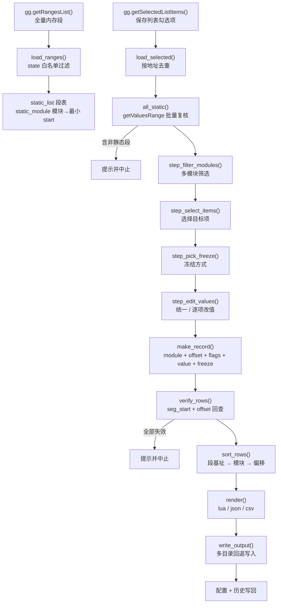

# Lib_Tool R1

> **GameGuardian 静态基址获取工具** —— 把「保存列表」里的绝对地址，换算成跨重启可复用的「模块名 + 偏移」，并导出为 Lua / JSON / CSV。

**简体中文** · [English](README.en.md)


[](https://github.com/xsnbyyds/Lib_Tool-R1/actions/workflows/ci.yml)

作者 / 反馈：**TG [@xsnbyyds](https://t.me/xsnbyyds)**

---

## 目录

- [项目简介](#项目简介)
- [核心特性](#核心特性)
- [工作原理](#工作原理)
- [环境要求](#环境要求)
- [安装](#安装)
- [快速开始](#快速开始)
- [使用流程详解](#使用流程详解)
- [输出格式](#输出格式)
- [生成脚本怎么用](#生成脚本怎么用)
- [配置文件](#配置文件)
- [仓库结构](#仓库结构)
- [技术要点](#技术要点)
- [已知限制与注意事项](#已知限制与注意事项)
- [常见问题与排错](#常见问题与排错)
- [函数索引](#函数索引)
- [许可证](#许可证)
- [免责声明](#免责声明)

---

## 项目简介

GameGuardian（下称 GG）的**搜索结果**与**保存列表**记录的是**绝对内存地址**。进程一旦重启，so 被重新映射到新的基址，昨天记下的 `0x7A1A2B3C` 就指向了完全无关的数据 —— 这也是绝大多数 GG 脚本「今天能用、明天失效」的根本原因。

`Lib_Tool` 做的事情只有一件：**把绝对地址还原成相对地址**。

在目标进程处于运行状态时，脚本读取 GG 的内存段表，判断每个勾选地址落在哪个已加载模块（so / 可执行文件）的哪个**静态段**内，然后用

```
偏移 = 绝对地址 − 该模块所有静态段中的最小 start
```

换算出段内偏移，最终交付一份 `模块名 + 偏移 + 类型(flags) + 初始值 + 是否冻结` 的记录。下次启动游戏后，只要该模块被重新加载，用

```
运行时基址 = gg.getRangesList("libxxx.so")[1].start
目标地址   = 运行时基址 + 偏移
```

就能重新定位到同一个数值 —— 这就是所谓「静态基址」。

脚本本身**不搜索、不修改、不读写游戏数据**，它只做地址换算与文件导出，全部写操作都发生在你自己指定的输出路径上。

---

## 核心特性

| 类别 | 能力 |
| --- | --- |
| **地址校验** | 静态段 `state` 白名单 + `gg.getValuesRange` 批量复核 + 偏移回查三重校验，非静态地址在入口处即被拦截 |
| **模块筛选** | 勾选项横跨多个 so 时可先按模块过滤，避免把无关模块的地址混进同一份配置 |
| **灵活取值** | 支持「统一改成一个值」或「逐项改值」，默认值预填保存列表中的原值 |
| **冻结控制** | 全部冻结 / 全部不冻结 / 逐项勾选，冻结状态随记录一起固化，排序后不会错位 |
| **多格式输出** | Lua 脚本、JSON、CSV 三种格式，可任选一种或一次全部输出，文件后缀自动派生 |
| **写入稳健性** | 规避 Android 11+ FUSE 陈旧 dentry 问题；4 种 `io.open` 模式轮询；目标路径不可写时自动降级到脚本目录 / `/sdcard` / `/storage/emulated/0`，必要时改名交付 |
| **路径归一化** | 兼容 `content://`、SAF 的 `tree/document` 形态、`primary:` 前缀、百分号转义，且不破坏 UTF-8 多字节文件名 |
| **配置持久化** | 文件 + GG 变量槽位**双存储**，任一可用即生效；配置文件损坏时自动回落默认值并提示 |
| **交互体验** | 悬浮按钮常驻，主菜单循环；点击空白处或返回键只取消当前步骤，不会误退出脚本 |
| **中英双语** | 全部界面文案走 i18n 词表，主菜单「Language / 语言」一键切换，选择写入配置，下次启动自动沿用 |
| **异常兜底** | 主循环内 `pcall` 包裹菜单，出错弹窗提示而非静默崩溃；`gg.sleep` 空档让出 CPU |

---

## 工作原理



一句话概括数据流：

```
内存段表 ──┐
           ├─→ 记录(模块, 偏移, flags, value, freeze) ─→ 排序 ─→ 渲染 ─→ 落盘 ─→ 配置记忆
勾选项 ────┘
```

---

## 环境要求

| 项目 | 要求 |
| --- | --- |
| 系统 | Android（需 root，或在支持 GG 的虚拟空间 / 双开环境中运行） |
| 宿主 | GameGuardian，且已**附加到目标进程** |
| 语言 | Lua，由 GG 内置解释器提供，无需额外安装；语法兼容 Lua 5.1–5.5 |
| 权限 | 写入目标目录所需的存储权限（Android 11+ 建议授予「所有文件访问」或改用应用私有目录） |
| 屏幕 | 任意，悬浮按钮会覆盖在游戏画面之上 |

脚本依赖的 GG API：

| API | 用途 |
| --- | --- |
| `gg.getFile()` | 推导脚本所在目录，作为默认输出/配置位置 |
| `gg.getRangesList()` | 获取内存段表；带参时按模块名过滤（生成的脚本中使用） |
| `gg.getValuesRange()` | 批量获取地址所属段状态，用于静态校验 |
| `gg.getSelectedListItems()` | 读取保存列表勾选项 |
| `gg.setValues()` / `gg.addListItems()` | 生成的 Lua 脚本中写值与冻结 |
| `gg.choice` / `gg.multiChoice` / `gg.prompt` / `gg.alert` / `gg.toast` | 全部交互 |
| `gg.showUiButton` / `gg.isClickedUiButton` / `gg.hideUiButton` | 悬浮按钮与主循环 |
| `gg.saveVariable` / `gg.getVariables` | 配置的变量槽位兜底存储 |
| `gg.sleep` | 主循环节流与写入后延迟校验 |

> 若某个 GG 版本缺少 `gg.saveVariable` / `gg.getVariables`，配置会退化为「仅文件存储」，功能不受影响（`write_cfg` 与 `cfg_blob_from_gg` 均已做存在性判断）。

---

## 安装

1. 下载 `Lib_Tool R1.lua`：直接取仓库里的文件，或从 [Releases](https://github.com/xsnbyyds/Lib_Tool-R1/releases) 下载（GitHub 会把附件名规范成 `Lib_Tool.R1.lua`，内容一致）。
2. 放到手机任意可读目录，常见选择：
   - `/sdcard/`（即 `/storage/emulated/0/`）
   - GG 自带的脚本目录
   - 通过 GG 的「执行脚本 → 选择文件」直接从下载目录载入
3. 打开 GG → 选择目标游戏进程（**必须先附加进程**）。
4. GG 侧边栏 → 执行脚本 → 选中 `Lib_Tool R1.lua`。
5. 首次运行会自动创建配置文件（见 [配置文件](#配置文件)），屏幕左上角出现悬浮按钮即表示启动成功。
6. 需要英文界面时，点悬浮按钮 → 主菜单「Language / 语言」。

---

## 快速开始

```
搜索数值 → 长按结果「保存到列表」 → 勾选左侧方框 → 运行本脚本 → 点悬浮按钮
        → 获取静态基址 → 按 6 步向导选择 → 得到 已输出的基址.lua
```

最省事的路径：**全选 → 全部不冻结 → 采用单调值（不改） → 只输出 Lua → 直接确定**。

---

## 使用流程详解

点击悬浮按钮后进入主菜单：

```
┌─────────────────────────────┐
│  Lib Tool R1                │
│  TG: @xsnbyyds              │
├─────────────────────────────┤
│  获取静态基址                │
│  Language / 语言             │
│  退出脚本                    │
└─────────────────────────────┘
```

- 选择 **获取静态基址** → 进入下方 9 个阶段。
- 选择 **Language / 语言** → 在中文与 English 之间切换，立刻生效并写入配置（`lang=zh` / `lang=en`），下次启动自动沿用。切换时会弹一条 toast 确认。
- 选择 **退出脚本** → 置 `RUNNING = false`，主循环结束，隐藏悬浮按钮，脚本退出。
- **点击空白处或按返回键** → `gg.choice` 返回 `nil`，菜单函数直接 `return`，主循环继续等待下一次点击（不会退出脚本）。
- 任意子步骤返回 `nil`（取消）→ 整条流程静默中止，回到主循环。

> 切换语言只影响**界面文案**：生成文件里的字段名、`module` / `offset` 等始终是英文，CSV 表头也不随语言变化，避免下游解析脚本因为语言切换而失效。

### 阶段总览

| # | 阶段 | 函数 | 交互 | 取消行为 |
| --- | --- | --- | --- | --- |
| 1 | 读取勾选项 | `step_pick_list` | 无（仅校验，失败弹窗） | 中止流程 |
| 2 | 模块筛选 | `step_filter_modules` | 模块 > 1 时才弹多选框 | 中止流程 |
| 3 | 选择目标项 | `step_select_items` | 多选框（首项为「全选」） | 中止流程 |
| 4 | 冻结方式 | `step_pick_freeze` | 单选框 + 可能追加多选框 | 中止流程 |
| 5 | 修改数值 | `step_edit_values` | 输入框 + 复选框混合表单 | 中止流程 |
| 6 | 偏移自检 | `verify_rows` | 有失效项时弹「继续/取消」 | 中止流程 |
| 7 | 输出格式 | `step_pick_formats` | 多选框（首项为「全部输出」） | 中止流程 |
| 8 | 输出路径 | `step_output_opts` | 路径输入 + 复选框 | 中止流程 |
| 9 | 写出与回执 | `write_output` | 结果弹窗 | — |

### 阶段 1 · 读取勾选项

```lua
local sel = load_selected()          -- gg.getSelectedListItems() + 按 address 去重
if not all_static(sel) then ... end  -- getValuesRange 批量复核
```

两种失败提示：

- **未勾选任何项** → `请先在保存列表勾选需要取址的数值`（附带操作路径提示）
- **包含非静态地址** → `勾选项中包含非静态地址`，因为堆 / 栈 / 匿名映射的地址每次重启都会变，换算出的偏移毫无意义

> 去重规则：同一 `address` 只保留第一次出现的那条，避免重复输出。

### 阶段 2 · 模块筛选

仅当勾选项横跨 **2 个及以上模块** 时才弹出，否则直接跳过。

```
┌──────────────────────────────┐
│  筛选用哪个 so                │
├──────────────────────────────┤
│  □ 全部模块（不筛选）          │
│  □ libil2cpp.so              │
│  □ libc.so                   │
└──────────────────────────────┘
```

- 勾选第 1 项 → 保留全部，忽略其余勾选。
- 勾选若干模块 → 只保留这些模块的项；**无法归属任何模块的项会被一并保留**（`module_of` 返回 `nil` 时不做过滤）。
- 过滤后为空 → 提示 `筛完之后没有剩余项`。

### 阶段 3 · 选择目标项

列表首项是 `全选（共 N 项）`，其余每项由 `describe()` 生成：

```
12345，类型：Dword[4]，地址：0x7A1A2B3C
```

勾选「全选」时忽略其他勾选，等价于全选。

### 阶段 4 · 冻结方式

| 选项 | 返回值 | 含义 |
| --- | --- | --- |
| 全部冻结 | `true` | 输出记录全部带 `freeze=true` |
| 全部不冻结 | `false` | 输出记录全部 `freeze=false` |
| 逐项勾选 | `table` | 再弹一次多选框，勾选项为 `true`，其余 `false` |

逐项表以 **`sel` 的下标**为键（而不是勾选后的紧凑下标），所以后续排序、过滤都不会造成冻结状态错位。这正是 `make_record` 把 `freeze` 一起固化进记录的原因。

### 阶段 5 · 修改数值

弹出一个「输入框 + 复选框」混合表单，第一项是单选值开关：

```
[    ] 单调值（勾选后统一改成这个值）   ← 文本框：统一写入的值
[✓] 采用单调值                        ← 复选框：勾选后忽略下面所有逐项输入
[12345] 12345，类型：Dword[4]，地址：0x7A1A2B3C
[   1 ] 1，类型：Float[16]，地址：0x7A1B0004
```

- **勾选「采用单调值」** → 所有项统一取上面文本框的值；文本框留空则按 `0` 处理。
- **不勾选** → 逐项使用各自输入框的内容，默认值预填保存列表里的原值。

数值解析由 `parse_num` 完成，容错能力较强：

| 输入 | 解析结果 | 说明 |
| --- | --- | --- |
| `12345` | 12345 | 十进制整数 |
| `12,345` | 12345 | 千位逗号被忽略 |
| `0x1A2B` | 6699 | 十六进制 |
| `100~200` | 200 | 取 `~` 后的上限（方便把搜索结果区间直接粘进来） |
| `-5` | -5 | 负数 |
| `1.5e3` | 1500 | 小数 / 科学计数法 |
| `inf` / `nan` / 空 | `nil` | 非有限数值一律判废 |

> 注意：输入值只是**写进输出文件的初始值**，脚本不会把它写回内存，也不会从内存回读校验。

### 阶段 6 · 偏移自检

对每条记录做一次回查：

```
seg_start + offset  是否仍落在某个静态段内？
```

- 有失效项 → `检测到 N 个偏移可能已失效（模块可能已卸载或地址已变）`，可选「继续」（只写剩余项）或「取消」。
- 全部失效 → 提示 `所有偏移都无法通过有效性校验` 并终止。
- 无失效项 → 静默通过，不打扰。

### 阶段 7 · 输出格式

```
┌────────────────────────────────────────┐
│  选择输出格式（可多选，一起输出）        │
├────────────────────────────────────────┤
│  □ 全部输出（lua + json + csv）         │
│  ☑ Lua 脚本 (.lua)                      │
│  □ JSON (.json)                         │
│  □ CSV (.csv)                           │
└────────────────────────────────────────┘
```

- 上次记住的格式会**预勾选**（来自配置文件 `formats` 字段）。
- 勾选「全部输出」→ 三种一起写。
- 一个都没选 → `请至少选择一种输出格式`，返回后回到主循环。

### 阶段 8 · 输出路径

```
输出文件路径（多格式自动换后缀）：  /storage/emulated/0/已输出的基址.lua
记住本次格式选择：                  [✓]
```

- 默认值取自配置 `out_path`，无配置时为 `脚本目录 + 已输出的基址.lua`。
- 若记住的路径以 `.tmp` 结尾（上一次写临时文件遗留），或不是以 `/` 开头，自动回退为默认路径。
- 路径为空 → `输出路径为空`。

路径随后经 `resolve_out_path` 归一化：合法绝对路径原样使用；不合法则落到「脚本目录 + 同名文件」；仍无法确定则提示 `输出路径不合法`。

### 阶段 9 · 写出与回执

多格式时，路径由 `format_paths` 派生 —— **替换扩展名，主干不变**：

```
基准 /sdcard/base.lua  +  {lua, json, csv}
  → /sdcard/base.lua
  → /sdcard/base.json
  → /sdcard/base.csv
```

每个格式独立调用 `write_output`，失败自动按 `原路径 → 脚本目录 → /sdcard → /storage/emulated/0` 顺序重试。最终回执示例：

```
写出完成（12 项，2 个格式）
/storage/emulated/0/base.lua
/storage/emulated/0/base.json

（部分原路径被占用/不可写，已改存到上面列出的路径）

以下格式写出失败：
csv：target path blocked by stale FUSE cache
```

全部失败时提示：

```
无法写入文件: /xxx/base.lua

已依次尝试脚本目录、/sdcard、/storage/emulated/0 均失败。
最后错误: ...
```

---

## 输出格式

三种格式共享同一份记录集合，字段一一对应：

| 字段 | 含义 | 来源 |
| --- | --- | --- |
| `module` | 模块名（仅文件名，不含路径） | `range.internalName` 经 `basename` 处理 |
| `offset` | 相对该模块最小静态段 start 的偏移，`0x` 大写十六进制 | `item.address − static_module[module]` |
| `flags` | GG 数值类型标识 | `item.flags` |
| `value_addr` | 生成时的绝对地址，仅作调试参考 | `item.address` |
| `value` | 用户确认的初始值（原样字符串） | 阶段 5 的输入 |
| `freeze` | 是否冻结 | 阶段 4 的结果 |

### Lua

```lua
function setvalue(address,flags,value,freeze) local tt={} tt[1]={} tt[1].address=address tt[1].flags=flags tt[1].value=value tt[1].freeze=freeze  gg.setValues(tt) for i=1,#tt do if tt[i].freeze then gg.addListItems(tt) break end end end--静态冻结配置

so=gg.getRangesList("libil2cpp.so")[1].start
py=0x1A2B3C
setvalue(so+py,4,9999,true)
py=0x1A2B50
setvalue(so+py,4,100)
so=gg.getRangesList("libc.so")[1].start
py=0x4E20
setvalue(so+py,16,1.5)
```

要点：

- 首行 `LUA_HEAD` 定义 `setvalue()` 封装：先 `gg.setValues`，若 `freeze` 为真再 `gg.addListItems` 加入保存列表。
- **每个模块只输出一次** `so=...`，随后连续输出该模块的所有偏移（记录已按模块聚拢）。
- `py` 为 `0x` 大写的偏移字面量；`value` 经 `parse_num` 解析后由 `num_to_literal` 输出（整数不带小数点，浮点保留小数）。
- 冻结项在末尾多一个 `,true`；不冻结则省略该参数（`nil`）。

### JSON

```json
[
  {"module":"libil2cpp.so","offset":"0x1A2B3C","flags":4,"value_addr":"0x7A1A2B3C","value":"9999","freeze":true},
  {"module":"libil2cpp.so","offset":"0x1A2B50","flags":4,"value_addr":"0x7A1A2B50","value":"100","freeze":false},
  {"module":"libc.so","offset":"0x4E20","flags":16,"value_addr":"0x7B004E20","value":"1.5","freeze":false}
]
```

- 手写序列化，无尾逗号，2 空格缩进，数组元素每行一条。
- 字符串转义覆盖 `\` `"` 及全部控制字符（`\b \f \n \r \t` 用短转义，其余用 `\uXXXX`）。
- `offset` / `value_addr` / `value` 均为**字符串**；`flags` 与 `freeze` 为原生类型。
- `value` 保持用户输入原样，若输入是 `100~200` 这类区间写法，JSON 里也会是原字符串 —— 下游消费时需自行解析。

### CSV

```csv
module,offset,flags,value_addr,value,freeze
libil2cpp.so,0x1A2B3C,4,0x7A1A2B3C,9999,true
libil2cpp.so,0x1A2B50,4,0x7A1A2B50,100,false
libc.so,0x4E20,16,0x7B004E20,1.5,false
```

- 首行固定表头，UTF-8 无 BOM（用 Excel 打开中文路径可能出现乱码，建议用支持 UTF-8 的编辑器）。
- 字段含 `,` `"` 或换行时整体用双引号包裹，内部引号翻倍（标准 RFC 4180 行为）。

### 类型标识对照

| flags | 名称 | flags | 名称 |
| --- | --- | --- | --- |
| `127` | `Auto[127]` | `4` | `Dword[4]` |
| `16` | `Float[16]` | `64` | `Double[64]` |
| `1` | `Byte[1]` | `8` | `Xor[8]` |
| `2` | `Word[2]` | `32` | `Qword[32]` |

表中未列出的 flags 会原样显示数字（`describe` 中 `TYPE_MAP[flags] or flags`），不会报错。

---

## 生成脚本怎么用

生成的 `.lua` 是**独立可执行**的，不依赖 `Lib_Tool` 本体：

1. 启动游戏，**先进入会让目标 so 被加载的界面**（例如登录后的主城 / 对局内），否则 `gg.getRangesList("libxxx.so")` 返回空表，取 `[1].start` 会报错。
2. 打开 GG → 附加进程 → 执行生成的脚本。
3. 脚本按顺序：取模块基址 → 逐个 `setvalue` 写值 → 冻结项加入保存列表。
4. 需要长期保持数值不变时，配合 GG 的「冻结」功能或脚本重复执行。

> **关键前提**：偏移只对**同一份模块二进制**有效。游戏更新、换 CPU 架构（arm64 ↔ armeabi-v7a）、换渠道包，都可能让偏移全部失效，需要重新生成。

---

## 配置文件

### 位置与优先级

| 优先级 | 路径 | 说明 |
| --- | --- | --- |
| 1 | `<脚本目录>/Lib_Tool.R1.cfg` | 首选，跟随脚本走 |
| 2 | `/sdcard/Lib_Tool.R1.cfg` | 脚本目录不可写时 |
| 3 | `/storage/emulated/0/Lib_Tool.R1.cfg` | 同上（多数机型与 2 等价） |
| 4 | GG 变量槽位 `Lib_Tool.R1.cfg` | 文件系统整体不可用时的兜底 |

读取时按顺序取第一个非空内容；写入时**文件与变量槽位双写**，任一成功即视为成功，两者都失败才提示 `配置保存失败（本次会话不记忆配置）`。

### 文件内容

```
out_path=/storage/emulated/0/已输出的基址.lua
formats=lua,json
lang=en
history_count=1
/storage/emulated/0/已输出的基址.lua
```

| 字段 | 说明 |
| --- | --- |
| `out_path` | 上次成功写出的文件路径，作为下次的默认值 |
| `formats` | 上次选择的格式，逗号分隔；非法项静默丢弃，顺序被规范化为 `lua,json,csv` |
| `lang` | 界面语言，`zh` 或 `en`；缺失或非法时回落 `zh` |
| `history_count` | 历史条数，当前上限 `HISTORY_MAX = 1` |
| 最后一行 | 历史路径，多个用 `\x1F`（单元分隔符）连接在同一行 |

`lang` 必须写在 `history_count` **之前**：解析器在 `history_count` 处 `break`，其后的行不再按 `key=value` 处理。

设计上的取舍：历史记录用**一行 + `\x1F` 分隔**而不是多行，是为了让「一行一个 `key=value`」的解析结构保持简单，同时值内的换行在写入前已被 `one_line` 替换成空格，不会破坏格式。

### 容错行为

| 异常 | 处理 |
| --- | --- |
| CRLF / 单独 CR 换行 | 统一转为 LF |
| 末尾空行 | 全部剔除 |
| 有效行少于 3 行 | 判定损坏，返回 `nil` |
| `history_count` 非数字或为负 | 判定损坏 |
| `history_count` 大于上限 | 截断为 `HISTORY_MAX` |
| 历史条目少于声明数量 | 有多少收多少，不整体判废 |
| 解析失败 | `gg.toast("配置已损坏，已恢复默认")` + 使用默认配置 |

---

## 仓库结构

```
Lib_Tool-R1/
├── Lib_Tool R1.lua      # 脚本本体（单文件，无外部依赖）
├── README.md            # 中文说明（本文件）
├── README.en.md         # English README
├── LICENSE              # PolyForm Noncommercial 1.0.0
├── .gitignore           # 忽略运行产物（cfg / 输出 / 临时文件）
├── .github/
│   └── workflows/
│       └── ci.yml       # CI：Lua 语法检查 + 冒烟测试
├── tests/
│   └── smoke_test.py    # 模拟 GG 环境的端到端测试
└── docs/
    ├── 技术实现.md       # 关键算法与内部机制详解
    ├── TECHNICAL.md     # Internals (English)
    ├── 函数索引.md       # 全部函数签名与职责表
    └── FUNCTIONS.md     # Function reference (English)
```

脚本为**单文件设计**，不 require、不读外部模块，拷贝一个 `.lua` 即可运行；文档与脚本可以分离维护。

### 自动化检查

每次 push / PR 会跑两个 job：

| Job | 内容 |
| --- | --- |
| `Lua syntax` | 用 Lua 5.4 对仓库内所有 `.lua` 做 `loadfile` 编译检查（只编译不执行，不需要真机） |
| `Smoke test` | 用 [lupa](https://github.com/scoder/lupa) 在**模拟的 GG 环境**里跑完整流程：切换语言 → 选格式 → 写出文件，再断言输出内容 |

本地复跑：

```bash
pip install lupa
python tests/smoke_test.py
```

冒烟测试不碰真实文件系统（`io` / `os` 全指向内存字典），也不依赖 root 或 GG，纯逻辑验证，所以在 CI 里能稳定跑。

---

## 技术要点

详细推导见 [`docs/技术实现.md`](docs/技术实现.md)，这里只列结论。

### 1. 静态段白名单

只接受四种 GG 内存段状态：

```lua
local STATIC_STATES = { Xa = true, Cb = true, Cd = true, Ps = true }
```

这四类通常对应模块的代码段与只读数据段（ELF 的 `.text` / `.rodata` / `.data.rel.ro` 等映射）。匿名可读写段、堆、栈一律排除 —— 它们的地址不具备跨重启稳定性。

> 不同 ROM / GG 版本对段状态的命名可能有差异，若发现合法地址被误判为「非静态」，扩展这个表即可，无需改动其他逻辑。

### 2. 偏移基准取「最小 start」而非「首个匹配」

```lua
local m = static_module[r.internalName]
if m == nil or r.start < m then static_module[r.internalName] = r.start end
```

同一模块会被映射成多个段（r-xp、r--p、rw-p…），基准统一取其中**最小的 start**，保证偏移在整个模块内单调且与段顺序无关。这样即便后续新增/删除某个段，偏移也不会整体漂移。

### 3. 三重校验

| 层 | 手段 | 拦截对象 |
| --- | --- | --- |
| 入口 | `getValuesRange` 批量查 state | 非静态地址 |
| 换算 | `range_of` 反查所属段 | 段表之外的地址 |
| 出口 | `seg_start + offset` 回查 | 换算后落到段外的脏数据 |

`getValuesRange` 一次调用即可拿到全部地址的段信息，避免逐条查询的性能损耗。

### 4. Android 11+ 的 FUSE 写入绕过

目标文件被外部删除后，FUSE 缓存可能仍保留旧 dentry，同进程再次创建同名路径会失败。策略是**写临时新名 → `os.rename` 覆盖**：

```
raw_write(.名字.lt<时间>_<序号>_<随机>.tmp)
  └─ rename(tmp, target)           ← 首选
     └─ 失败 → remove(target) → rename 再试
        └─ 失败 → remove → 直接写 target
           └─ 失败 → 改用「原名_<时间戳>.<ext>」交付
              └─ 仍失败 → 探测 tmp 可读则交付 tmp
                 └─ 否则报错 "target path blocked by stale FUSE cache"
```

判据优先级：**写 / 关闭的返回值是主判据**，读回探测只作旁证（分区存储下常见「写成功但立刻读不到」）。临时文件清理失败时会改名为 `.bak`，避免污染目录。

### 5. 路径归一化

`norm_path` 依次剥离 `content://`、`file://`、`document://`、任意 `scheme://`，还原 `%XX` 中会改变语义的四个字符（`%` `/` `:` 空格），处理 SAF 的 `/tree/<tree>/document/<doc>` 形态与 `primary:` 前缀，最后把反斜杠统一成正斜杠。

**只还原四个字符**是刻意为之：全量 `%XX` 解码会把 UTF-8 中文文件名的多字节序列拆坏，而其余转义（如 `%2C`）对路径语义无影响，保留原样更安全。

### 6. 数值与输出的安全边界

- `hex_addr` 先判类型、判 `nan/inf`、再 `math.floor`，避免 `%X` 遇到非整数抛错。
- `num_to_literal` 保证整数值输出为 `12345` 而不是 `12345.0`。
- `sort_rows` 按 `tonumber(offset)` 比较 —— 字符串比较会让 `"0x1000" < "0x80"` 成立，导致排序错乱。

### 7. 交互索引映射

`gg.prompt` / `gg.multiChoice` 的下标是 1-based 且会被「全选」「单调值」这类前置项挤位，脚本统一采用「**前置项占 1 位，业务项从 2 开始，取用时减 1**」的规则，并用 `keys[]` 保存原始下标，避免多轮筛选后索引错位。详见 [`docs/技术实现.md`](docs/技术实现.md)。

### 8. 多语言（i18n）

全部界面文案集中在两张词表里，代码里只保留 key：

```lua
local STR = { zh = { ... }, en = { ... } }

local function t(k, ...)
  local pack = STR[LANG] or STR.zh
  local s = pack[k] or STR.zh[k] or tostring(k)   -- 缺词逐级回落，绝不因缺词崩流程
  ...
end
```

三条约定：

1. **语言是运行时状态**：`LANG` 由配置项 `lang` 决定，`read_cfg` 读到合法值即刻生效，所以任何一次读配置都会让界面语言对齐用户上次的选择。
2. **切换要防止被配置覆盖**：`toggle_lang()` 先算出目标语言，再读配置（读配置会把 `LANG` 拉回旧值），最后才覆盖 `LANG` 并写回。顺序反了就会变成「切了但没变」。
3. **生成文件不翻译**：`module` / `offset` / `flags` / CSV 表头等始终英文，只有界面文案走词表 —— 下游解析脚本不会因为界面语言变化而失效。

新增语言只需加一张 `STR.xx` 表并在 `toggle_lang` 里扩展轮换顺序，其余代码不用动。

---

## 已知限制与注意事项

| 限制 | 影响 | 缓解方式 |
| --- | --- | --- |
| 仅支持静态段地址 | 堆 / 栈 / 匿名映射的地址会被拒绝 | 改用「搜索 → 找指针链」的方式定位，本工具不处理指针扫描 |
| 偏移与模块二进制绑定 | 游戏更新后偏移全部失效 | 更新后重新生成 |
| 依赖模块已加载 | 未进入游戏主逻辑时模块可能尚未映射 | 先生成、后使用；生成时也需在模块已加载的状态下操作 |
| 段表仅启动时采集一次 | 脚本启动后才加载的模块不在段表内，相关勾选项会被静默丢弃 | **先进入游戏、等目标 so 加载完成，再运行脚本**；中途新加载模块需重启脚本 |
| `getRangesList(name)[1]` 取首个匹配 | 同一 so 存在多份映射（多进程 / 双开 / 插件注入）时可能取错 | 确认进程唯一；必要时手工改写生成脚本中的基址取法 |
| Lua number 为双精度 | 超过 2^53 的 64 位地址/数值会丢精度 | 避免对超大 `Qword` 值做精确编辑 |
| 配置历史仅保留 1 条 | 无法回看多次输出记录 | 修改 `HISTORY_MAX` 可放开（解析端已支持多值） |
| 输出文件默认名为中文 | 个别 ROM 或第三方工具可能乱码 | 在路径输入框中改成 ASCII 文件名 |
| `flags` 缺失时 | 生成脚本会出现 `setvalue(so+py,nil,...)` | 确保勾选项来自正常搜索结果 |
| 段状态命名差异 | 少数 ROM 下合法地址被误判非静态 | 扩展 `STATIC_STATES` |

其他注意点：

- **`value` 是输入值，不是内存现值**。脚本不回读内存，生成文件里的数值以你在阶段 5 确认的内容为准。
- **JSON / CSV 的 `value` 保持字符串原样**，`0x` 前缀与 `A~B` 区间写法不会被转换，需要下游自行处理。
- **写入失败会改存到其他路径**，回执中会明确列出实际路径，请以回执为准而不是以输入框中的路径为准。
- **不要在多开环境中混用配置**：配置文件路径固定，多个实例可能互相覆盖。

---

## 常见问题与排错

**Q1. 启动就提示「未检测到内存段」？**
脚本在入口处检查 `#gg.getRangesList() == 0`。说明尚未附加进程，或目标进程已被系统回收。回到 GG 主界面重新选择进程即可。

**Q2. 提示「勾选项中包含非静态地址」？**
说明至少有一项落在堆 / 栈 / 匿名段。这些地址重启必变，工具拒绝生成是正确的行为。请只勾选来自 so 内部的数值，或改用指针链方案。

**Q3. 提示「配置已损坏，已恢复默认」？**
配置文件被截断或手工改坏。删除 `Lib_Tool.R1.cfg` 后重启脚本会自动重建；GG 变量槽位中的副本也会在下次写入时被覆盖。

**Q4. 写入失败，报 `stale FUSE cache`？**
目标路径的 dentry 已彻底坏死。工具会自动改存到「原名_时间戳」或脚本目录，按回执里的路径去取文件即可；若持续失败，换一个目录（如 `/sdcard/Download/`）。

**Q5. 生成的 Lua 脚本运行报错 `attempt to index a nil value`？**
`gg.getRangesList("libxxx.so")` 返回空表 —— 模块尚未加载。先进游戏到会加载该 so 的界面再执行。

**Q6. 生成的脚本执行了，但数值没变？**
可能原因：① 偏移已随游戏更新失效；② 写入的值与类型不匹配（例如给 `Dword` 写了 `1.5`）；③ 该地址被服务端校验或反作弊拦截；④ 值被游戏逻辑在下一帧覆盖（未勾选冻结）。

**Q7. 悬浮按钮不出现？**
确认 GG 的悬浮窗权限已授予，且脚本已执行到最后的主循环。部分 GG 版本在脚本报错退出后会残留按钮，重新运行即可。

**Q8. 输出里 `value_addr` 有什么用？**
它是生成时的绝对地址，仅用于对照排查（比如回到 GG 里手动确认这个地址当前的值）。重启后该字段必然失效，不要用它来定位。

**Q9. 能一次输出多种格式吗？**
可以。阶段 7 勾选「全部输出」或多选若干项，脚本会为每种格式派生一个同名不同后缀的文件。

**Q10. 怎么把界面切成英文？**
点悬浮按钮 → 主菜单第二项「Language / 语言」，点一下即切到 English 并弹出 toast 确认；再点一次切回中文。选择写入配置文件 `lang=zh|en`，下次运行自动沿用。切换只影响界面文案，生成文件的字段名与 CSV 表头始终是英文。

**Q11. 语言切了但重启又变回中文？**
说明配置没写成功（会弹 `配置保存失败` 或 `Failed to save config`）。检查脚本目录、`/sdcard`、`/storage/emulated/0` 的写权限，或确认 GG 变量槽位可用。

---

## 函数索引

完整签名与参数说明见 [`docs/函数索引.md`](docs/函数索引.md)，此处为分组概览。

| 分组 | 函数 |
| --- | --- |
| 工具 | `has_text` `trim` `basename` `dirname` `is_true` `split_name` `norm_path` `path_ok` |
| 文件后端 | `uniq_suffix` `raw_write` `safe_remove` `probe_readable` `drop_tmp` `try_write` `resolve_out_path` |
| 数值 | `parse_num` `num_to_literal` `hex_addr` `describe` |
| 采集 | `load_ranges` `range_of` `module_of` `load_selected` `all_static` `collect_chosen` |
| 业务 | `make_record` `verify_rows` `sort_rows` `frozen` |
| 格式化 | `fmt_lua` `json_q` `fmt_json` `csv_field` `fmt_csv` `render` `normalize_formats` `parse_formats` `format_paths` |
| 配置 | `default_cfg` `one_line` `serialize` `deserialize` `cfg_blob_from_file` `cfg_blob_from` `cfg_blob_from_gg` `read_cfg` `write_cfg` `history_push` `ensure_cfg` |
| 多语言 | `t` `fmt_label` `toggle_lang` |
| 界面 | `step_pick_list` `step_filter_modules` `step_select_items` `step_pick_freeze` `step_edit_values` `step_pick_formats` `step_output_opts` `write_output` `flow_static_address` `main_menu` |

---

## 许可证

本项目基于 **[PolyForm Noncommercial License 1.0.0](LICENSE)** 发布，Copyright (c) 2026 xsnbyyds。

**允许**：个人学习、研究、实验、业余项目、教学，以及慈善 / 教育 / 公共研究 / 公共安全与卫生 / 环保 / 政府机构等**任何非商业用途**下的使用、修改与再分发。

**不允许**：任何**商业用途**，包括但不限于销售本软件或其修改版、用于付费服务或商业产品、代练 / 商业外挂、以营利为目的的内部使用。商业使用需另行获得作者书面授权（TG [@xsnbyyds](https://t.me/xsnbyyds)）。

再分发时须随附本协议或协议地址，并保留 `Required Notice` 行。软件按「原样」提供，不含任何担保。

> **这不是 OSI 开源协议**：PolyForm Noncommercial 属于「源码可用（source-available）」，源码公开但商业使用受限，因此不能称为严格意义上的开源项目。

---

## 免责声明

本项目为 **Lua 语言与 Android 内存布局的学习示例**，用于在**自己的设备**上研究内存段结构、ELF 映射与地址换算原理。

使用者应自行确保：

- 仅在**自己拥有或获得授权**的设备与进程上使用；
- 遵守目标应用的服务条款、所在地区法律法规及平台规则；
- 不将本工具用于商业外挂、代练、账号交易或其他破坏公平性的用途。

作者不对因使用本工具产生的任何直接或间接后果负责。**下载或运行即表示你已理解并接受上述约定。**

---

<p align="center">
  <sub>Lib_Tool R1 · PolyForm NC · TG <a href="https://t.me/xsnbyyds">@xsnbyyds</a></sub>
</p>
